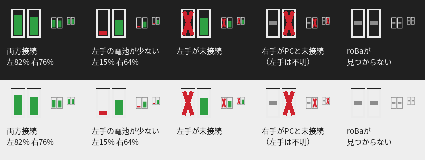

# roba-monitor

roBa の **左右それぞれの接続状態と電池残量** を、Windows のタスクトレイに表示するツールです。



アイコンの左の棒が左手、右の棒が右手です。

- **棒の高さと色**：電池残量です。50% 超は緑、20% 超は黄、それ以下は赤で表示します。
- **赤い ×**：未接続です。右の棒なら右手と PC の接続が、左の棒なら左手と右手の接続が切れています。
- **灰色の横線**：状態が分からないときの表示です。右手が PC とつながっていないと、左手の状態も確認できません。

アイコンをクリックするとメニューが開き、詳しい状態と最終確認時刻が表示されます。次のときは Windows の通知でもお知らせします。

- 左手と右手の接続が切れた／再接続したとき
- 右手と PC の接続が切れた／再接続したとき
- 左右それぞれの電池が 20%・10% を下回ったとき

状態は `data/battery_log.csv` に記録されます。変化があったときと 30 分ごとに 1 行ずつ追記するので、あとで電池の持ちを分析するのに使えます。

## BT1〜BT5 がどの端末か

メニューの中ほどに、roBa の Bluetooth 設定（BT1〜BT5）それぞれのペアリング相手が表示されます。

```
BT 設定（今の状態）
  BT1: この PC（選択中・接続中）
  BT2: iPad
  BT3: 空き
  BT4: 空き
  BT5: 空き
```

- **この PC** は自動で判定します（PC の Bluetooth アドレスと照らし合わせます）。
- ほかの端末は、最初はアドレス（`AA:BB:CC:DD:EE:FF`）で表示されます。メニューの「端末の名前を編集」を選ぶと `data/device_names.txt` がメモ帳で開くので、`アドレス = 名前` の行の先頭の `#` を消して名前を書き、保存してください。次の確認（15 秒以内）から名前で表示されます。
- 右手がこの PC につながっている間だけ、最新の一覧を読めます。別の端末に切り替えている間は、最後に読んだ一覧を「（最後に読んだ 10/28 19:30 時点）」のように表示します。
- 使うには、右手に `CONFIG_ROBA_BT_PROFILE_INFO=y` のファームウェア（リポジトリの `src/bt_profile_info.c`）を書き込む必要があります。古いファームでは「まだ読めていません」と表示されるだけで、電池の表示は今までどおり動きます。

## 仕組み

ファームウェアの変更は不要です。今の設定（`roBa_R.conf`）のまま動きます。

- 右手（セントラル）は PC に Battery Service を 2 つ公開しています。
  - 右手自身の電池残量
  - 左手の電池残量の代理値（説明 "Peripheral 0"）。`CONFIG_ZMK_SPLIT_BLE_CENTRAL_BATTERY_LEVEL_PROXY=y` によるものです。
- 左手が右手から切断されると、右手は左手の値を **0%** にして PC に通知します（ZMK の `split_central_disconnected`）。このツールは 0% を「左手が未接続」と判定します。
- 右手と PC の接続状態は、Windows が管理している接続状態をそのまま読みます。

このツールは、Windows がキーボードとして維持している接続をそのまま使って値を読むだけです。ペアリングをやり直したり、接続を奪ったりはしません。確認は 15 秒ごとに行います。

## セットアップ

1. Python 3.12 か 3.13 を入れます（既に入っていれば不要です）。
   ```
   winget install Python.Python.3.13
   ```
2. このフォルダで `setup.cmd` を実行します。`.venv` を作り、必要なライブラリを入れます。
3. `check.cmd` を実行すると、今の状態が 1 回だけ表示されます。
   ```
   右手（PC と）: 接続中 76%
   左手（右手と）: 接続中 82%
   ```
4. `start.cmd` でタスクトレイに常駐します。
5. サインイン時に自動で起動したい場合は `install-startup.cmd` を実行します。やめるときは `uninstall-startup.cmd` です。

Windows のタスクトレイでは、新しいアイコンが「隠れているアイコン（^）」に入ることがあります。常に見えるようにするには、設定 → 個人用設定 → タスクバー → 「その他のシステムトレイアイコン」で roba-monitor をオンにしてください。

## うまく動かないとき

`diagnose.cmd` を実行すると、Windows から見えている GATT の情報がすべて `data/diagnose.txt` に保存されます。内容を Claude に渡せば、原因を調べられます。動作ログは `data/monitor.log` に残ります。

| 表示 | 主な原因 |
|---|---|
| roBa が見つかりません | Windows の Bluetooth 設定で roBa がペアリングされていない、または名前が違う（`--name` で指定可能） |
| 右手: 未接続 | 右手が別の機器（BT プロファイル）に接続中、スリープ中、または電源オフ |
| 左手: 未接続 | 左手の電源オフ、電池切れ、または右手との距離が遠い |
| 左手: 不明（右手は接続中） | ファームウェアで電池残量の代理機能（BATTERY_LEVEL_PROXY）が無効になっている |

## オプション

```
python -m roba_monitor [--name roBa] [--interval 15] [--data-dir DIR] [--once | --diagnose]
```

## 開発

判定ロジック（`model.py`）とアイコン描画（`icon.py`）は Windows に依存しないので、どの OS でもテストできます。

```
pip install pytest Pillow
python -m pytest
```
